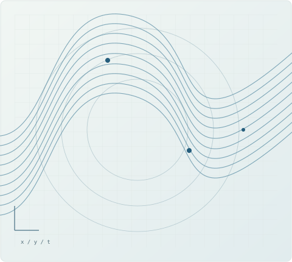
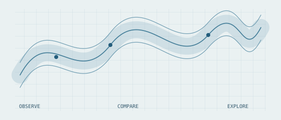
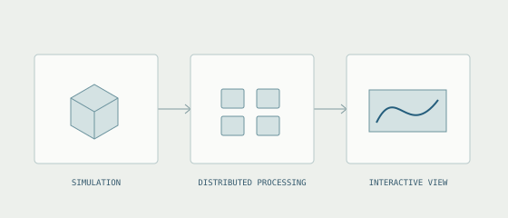

<section class="hero" aria-labelledby="profile-title">

World models · Generative graphics · Efficient AI

<h1 id="profile-title">Madhu Srinivasan</h1>

I work on generative world models, real-time graphics, and efficient AI.

Principal Research Staff at AMD Research, where I lead a team that investigated and built the company's world-model agenda and its fine-tuning and post-training pipelines. Previously Lead Scientist at HPE Cray and founding staff of KAUST's Visualization Core Lab.

<a class="primary-link" href="./projects.html">Explore my work ↗</a>

<a href="mailto:madhu.srinivasan@outlook.com">Email</a><a href="https://scholar.google.com/citations?user=GxzYUjQAAAAJ">Google Scholar</a><a href="https://github.com/secunit64">GitHub · secunit64</a><a href="https://github.com/madhuatx">GitHub · madhuatx</a><a href="https://www.linkedin.com/in/madsrini/">LinkedIn</a><a href="https://x.com/secunit64">X · @secunit64</a><a href="./doc/resume.pdf">Résumé (PDF)</a>

<figure class="hero-figure">

<figcaption>Form, motion, and computation.</figcaption>
</figure>
</section>

<strong>AMD Research</strong> · 2022 to present<strong>HPE Cray</strong> · 2019–2022<strong>KAUST</strong> · 2009–2019

<h2>Selected work</h2><a href="./projects.html">All projects ↗</a>

<article class="project-card">

Visual analytics · KAUST
<h3><a href="./projects/red-sea-atlas.html">Seeing the Red Sea</a></h3>

Visual analytics for researchers studying ocean and atmospheric data, from nutrient transport to extreme events.

Earth scienceMultivariate data

</article>
<article class="project-card">

Scientific visualization · KAUST
<h3><a href="./projects/large-scale-visualization.html">Exploring data at scale</a></h3>

Distributed and streaming workflows that bring large combustion simulations into interactive scientific exploration.

HPCInteractive graphics

</article>

<section class="research-note">
<h2>Current interests</h2>

My research interests include controllable world models, consistent long-context generation, and the hardware and software needed for real-time inference. My earlier work spans scientific visualization, immersive environments, and character animation.

</section>
