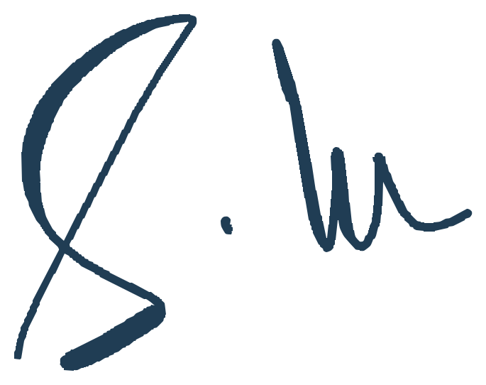
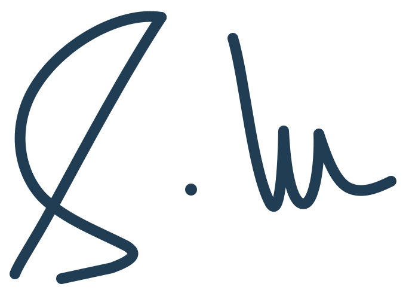

<style>
@font-face {
  font-family: "Sacramento";
  src: url("./assets/fonts/sacramento/Sacramento-Regular.ttf") format("truetype");
  font-weight: 400;
  font-style: normal;
  font-display: swap;
}
@font-face {
  font-family: "Allura";
  src: url("./assets/fonts/allura/Allura-Regular.ttf") format("truetype");
  font-weight: 400;
  font-style: normal;
  font-display: swap;
}
@font-face {
  font-family: "Great Vibes";
  src: url("./assets/fonts/greatvibes/GreatVibes-Regular.ttf") format("truetype");
  font-weight: 400;
  font-style: normal;
  font-display: swap;
}
@font-face {
  font-family: "Pinyon Script";
  src: url("./assets/fonts/pinyonscript/PinyonScript-Regular.ttf") format("truetype");
  font-weight: 400;
  font-style: normal;
  font-display: swap;
}
@font-face {
  font-family: "Bickham Local";
  src: local("Bickham Script Pro 3"), local("BickhamScriptPro3-Regular"),
       local("Bickham Script Pro"), local("BickhamScriptPro-Regular");
  font-weight: 400;
  font-style: normal;
}
@font-face {
  font-family: "Burgues Local";
  src: local("Burgues Script"), local("BurguesScript");
  font-weight: 400;
  font-style: normal;
}
</style>

<p class="eyebrow">Temporary design studio</p>

# A small mark, a personal signature.

<p class="lede">Two custom <strong>S.M</strong> vectors based on your signature, alongside the earlier typeface studies and original <strong>ms.</strong>.</p>

<div class="studio-note"><p>The large specimen explores character; the small one shows how it would feel in your navigation. Open-source script fonts are self-hosted. Bickham and Burgues render only when a genuine local font is available; no substitutes are shown.</p></div>

<div class="study-shell">
<fieldset class="surface-picker">
<legend>Preview surface</legend>
<label><input type="radio" name="surface" id="surface-paper" value="paper" checked> Paper</label>
<label><input type="radio" name="surface" id="surface-ink" value="ink"> Ink</label>
<span class="surface-hint">Changes the specimens, not your site.</span>
</fieldset>
<section class="custom-studies" id="custom-studies" aria-labelledby="custom-title">
<p class="eyebrow">New · Drawn from your signature</p>
<h2 id="custom-title">Your handwriting, made into a mark.</h2>
<p class="signature-intro">Only the S, period, and M were isolated from your screenshot. Both files are standalone SVG artwork, with no font dependency or embedded raster image.</p>
<div class="custom-grid">

<article class="monogram-card" id="monogram-15">
<div class="monogram-stage vector-art">
<span class="specimen-label">15 / Faithful trace</span>
<div class="vector-specimen"></div>
<div class="vector-sizes" aria-label="Faithful monogram at navigation sizes">
<div><span>24 px</span></div>
<div><span>32 px</span></div>
<div><span>48 px</span></div>
</div>
<div class="context-preview" aria-hidden="true"><span class="mini-navigation">Projects <span>About</span></span></div>
</div>
<div class="study-description"><h3>The original hand</h3><p>Preserves your proportions, long S descender, angular lower return, rounded M, and the natural variation in pen width. Lightly smoothed vector outlines retain the handwritten character.</p><a class="vector-download" href="./assets/monograms/sm-faithful.svg" download="sm-faithful.svg">Download faithful SVG</a></div>
</article>

<article class="monogram-card recommended" id="monogram-16">
<div class="monogram-stage vector-art">
<span class="specimen-label">16 / Navigation-ready</span>
<div class="vector-specimen"></div>
<div class="vector-sizes" aria-label="Simplified monogram at navigation sizes">
<div><span>24 px</span></div>
<div><span>32 px</span></div>
<div><span>48 px</span></div>
</div>
<div class="context-preview" aria-hidden="true"><span class="mini-navigation">Projects <span>About</span></span></div>
</div>
<div class="study-description"><h3>The compact signature</h3><p>A redraw for small sizes: fewer curves, even stroke weight, a clearer period, and a shorter lower S. Keeps the loop, diagonal crossing, and the M's rounded arches.</p><a class="vector-download" href="./assets/monograms/sm-navigation.svg" download="sm-navigation.svg">Download navigation SVG</a></div>
</article>

</div>
</section>
<section class="looped-studies" id="looped-studies" aria-labelledby="looped-title">
<p class="eyebrow">New · Swash-script candidates</p>
<h2 id="looped-title">Looking for your looped S.</h2>
<p class="signature-intro">Compare the actual S glyph before choosing. Swash settings request alternate shapes where the font supports them; they cannot manufacture a loop.</p>
<div class="monogram-grid">

<article class="monogram-card" id="monogram-12">
<div class="monogram-stage">
<span class="specimen-label">12 / Pinyon Script</span>
<div class="monogram signature-script signature-pinyon" role="img" aria-label="Pinyon Script capital S, period, capital M">S.M</div>
<div class="signature-name signature-script signature-pinyon">S.Madhusudhanan</div>
<div class="context-preview" aria-hidden="true"><span class="small-mark signature-script signature-pinyon">S.M</span><span class="mini-navigation">Projects <span>About</span></span></div>
<label class="swash-control"><input type="checkbox" class="swash-toggle"> Request swash alternates</label>
</div>
<div class="study-description"><h3>Pinyon Script</h3><p>Round-hand script with slanted, high-contrast strokes. This is the freely usable option, with the actual font loaded here.</p><span class="type-note">Self-hosted · SIL Open Font License</span><p class="font-source"><a href="./assets/fonts/pinyonscript/OFL.txt">Font license</a></p></div>
</article>

<article class="monogram-card local-font-card" id="monogram-13" data-font-family="Bickham Local">
<div class="monogram-stage">
<span class="specimen-label">13 / Bickham Script Pro</span>
<div class="local-font-preview" hidden>
<div class="monogram signature-script signature-bickham" role="img" aria-label="Bickham Script capital S, period, capital M">S.M</div>
<div class="signature-name signature-script signature-bickham">S.Madhusudhanan</div>
<div class="context-preview" aria-hidden="true"><span class="small-mark signature-script signature-bickham">S.M</span><span class="mini-navigation">Projects <span>About</span></span></div>
<label class="swash-control"><input type="checkbox" class="swash-toggle"> Request swash alternates</label>
</div>
<div class="font-unavailable"><span class="availability-label">Local font required</span><p>Install a licensed Bickham Script Pro font and reload to preview your initials.</p><a href="https://fonts.adobe.com/fonts/bickham-script">View Adobe specimen</a></div>
</div>
<div class="study-description"><h3>Bickham Script Pro</h3><p>A formal script with many alternate capitals. Compare the default and swash forms to find the S shape you want.</p><span class="type-note font-local-status">Local preview not checked. No font is bundled.</span></div>
</article>

<article class="monogram-card local-font-card" id="monogram-14" data-font-family="Burgues Local">
<div class="monogram-stage">
<span class="specimen-label">14 / Burgues Script</span>
<div class="local-font-preview" hidden>
<div class="monogram signature-script signature-burgues" role="img" aria-label="Burgues Script capital S, period, capital M">S.M</div>
<div class="signature-name signature-script signature-burgues">S.Madhusudhanan</div>
<div class="context-preview" aria-hidden="true"><span class="small-mark signature-script signature-burgues">S.M</span><span class="mini-navigation">Projects <span>About</span></span></div>
<label class="swash-control"><input type="checkbox" class="swash-toggle"> Request swash alternates</label>
</div>
<div class="font-unavailable"><span class="availability-label">Local font required</span><p>Install a licensed Burgues Script font and reload to preview your initials.</p><a href="https://www.sudtipos.com/font/burgues-script">View Sudtipos specimen</a></div>
</div>
<div class="study-description"><h3>Burgues Script</h3><p>A more ornate script with flourished capitals and multiple alternate forms. Give its larger swashes extra space.</p><span class="type-note font-local-status">Local preview not checked. No font is bundled.</span></div>
</article>

</div>
<p class="premium-note">Commercial font files are not downloaded or distributed by this page. Local previews need an installed font that your browser can access. Publishing one would require an appropriate font license or a permitted outlined logo asset.</p>
</section>
<section class="signature-studies" id="signature-studies" aria-labelledby="signature-title">
<p class="eyebrow">New · Your signature order</p>
<h2 id="signature-title">S.M, in your own order.</h2>
<p class="signature-intro">These explore your signature's initials and rhythm. They are typeface studies, not a tracing of your handwriting.</p>
<div class="monogram-grid">

<article class="monogram-card recommended" id="monogram-09">
<div class="monogram-stage">
<span class="specimen-label">09 / Monoline signature</span>
<div class="monogram signature-script signature-monoline" role="img" aria-label="Cursive capital S, period, capital M">S.M</div>
<div class="signature-name signature-script signature-monoline">S.Madhusudhanan</div>
<div class="context-preview" aria-hidden="true"><span class="small-mark signature-script signature-monoline">S.M</span><span class="mini-navigation">Projects <span>About</span></span></div>
</div>
<div class="study-description"><h3>The everyday signature <span class="pick">Pick</span></h3><p>Light, flowing strokes and a readable M. My first choice for a personal mark that still feels restrained in the navigation.</p><span class="type-note">Sacramento · monoline · S.M</span></div>
</article>

<article class="monogram-card" id="monogram-10">
<div class="monogram-stage">
<span class="specimen-label">10 / Connected script</span>
<div class="monogram signature-script signature-connected" role="img" aria-label="Flowing capital S, period, capital M">S.M</div>
<div class="signature-name signature-script signature-connected">S.Madhusudhanan</div>
<div class="context-preview" aria-hidden="true"><span class="small-mark signature-script signature-connected">S.M</span><span class="mini-navigation">Projects <span>About</span></span></div>
</div>
<div class="study-description"><h3>A flowing pair</h3><p>Closer spacing and sweeping strokes pull the initials together. The most fluid option, with a little more flourish.</p><span class="type-note">Allura · connected-script style · S.M</span></div>
</article>

<article class="monogram-card" id="monogram-11">
<div class="monogram-stage">
<span class="specimen-label">11 / Calligraphic</span>
<div class="monogram signature-script signature-calligraphic" role="img" aria-label="Calligraphic capital S, period, capital M">S.M</div>
<div class="signature-name signature-script signature-calligraphic">S.Madhusudhanan</div>
<div class="context-preview" aria-hidden="true"><span class="small-mark signature-script signature-calligraphic">S.M</span><span class="mini-navigation">Projects <span>About</span></span></div>
</div>
<div class="study-description"><h3>The formal signature</h3><p>Thick and thin strokes give the initials a more ceremonial character. Best if you want the monogram to feel like a signed piece of work.</p><span class="type-note">Great Vibes · calligraphic · S.M</span></div>
</article>

</div>
<details class="font-credits"><summary>Script typefaces and licenses</summary><p>Original, unmodified fonts from the <a href="https://github.com/google/fonts">Google Fonts collection</a>, hosted with this page under the SIL Open Font License: <a href="./assets/fonts/sacramento/OFL.txt">Sacramento</a>, <a href="./assets/fonts/allura/OFL.txt">Allura</a>, and <a href="./assets/fonts/greatvibes/OFL.txt">Great Vibes</a>.</p></details>
</section>

<h2 class="earlier-title">Earlier studies</h2>

<div class="monogram-grid">

<article class="monogram-card">
<div class="monogram-stage">
<span class="specimen-label">00 / Original</span>
<div class="monogram monogram-current" role="img" aria-label="m s, period">ms<span class="mark-dot">.</span></div>
<div class="context-preview" aria-hidden="true"><span class="small-mark monogram-current">ms<span class="mark-dot">.</span></span><span class="mini-navigation">Projects <span>About</span></span></div>
</div>
<div class="study-description"><h2>Keep the original</h2><p>Bold system sans, tight spacing, blue punctuation. Direct and easy to recognize at small sizes.</p><span class="type-note">System sans · bold · ms.</span></div>
</article>

<article class="monogram-card recommended">
<div class="monogram-stage">
<span class="specimen-label" id="editorial-mark">01 / Editorial</span>
<div class="monogram monogram-editorial" role="img" aria-label="m s, period">ms<span class="mark-dot">.</span></div>
<div class="context-preview" aria-hidden="true"><span class="small-mark monogram-editorial">ms<span class="mark-dot">.</span></span><span class="mini-navigation">Projects <span>About</span></span></div>
</div>
<div class="study-description"><h2>The researcher's mark <span class="pick">Active</span></h2><p>A quieter serif that echoes your page headings. This is the selected monogram for the site header and favicon.</p><span class="type-note">Georgia · regular · ms.</span></div>
</article>

<article class="monogram-card recommended">
<div class="monogram-stage">
<span class="specimen-label">02 / Humanist</span>
<div class="monogram monogram-humanist" role="img" aria-label="m s, period">ms<span class="mark-dot">.</span></div>
<div class="context-preview" aria-hidden="true"><span class="small-mark monogram-humanist">ms<span class="mark-dot">.</span></span><span class="mini-navigation">Projects <span>About</span></span></div>
</div>
<div class="study-description"><h2>A softer modernist <span class="pick">Pick</span></h2><p>Open, rounded forms with a little more breathing room. The closest alternative to the current mark.</p><span class="type-note">Avenir Next / system sans · medium · ms.</span></div>
</article>

<article class="monogram-card">
<div class="monogram-stage">
<span class="specimen-label">03 / Italic</span>
<div class="monogram monogram-italic" role="img" aria-label="m s, period">ms<span class="mark-dot">.</span></div>
<div class="context-preview" aria-hidden="true"><span class="small-mark monogram-italic">ms<span class="mark-dot">.</span></span><span class="mini-navigation">Projects <span>About</span></span></div>
</div>
<div class="study-description"><h2>A written signature</h2><p>Slanted serif forms give the initials a sense of motion. More personal, with less of a studio-logo feel.</p><span class="type-note">Georgia · italic · ms.</span></div>
</article>

<article class="monogram-card">
<div class="monogram-stage">
<span class="specimen-label">04 / Technical</span>
<div class="monogram monogram-mono" role="img" aria-label="m, period, s, period">m<span class="mark-dot">.</span>s<span class="mark-dot">.</span></div>
<div class="context-preview" aria-hidden="true"><span class="small-mark monogram-mono">m<span class="mark-dot">.</span>s<span class="mark-dot">.</span></span><span class="mini-navigation">Projects <span>About</span></span></div>
</div>
<div class="study-description"><h2>Initials as code</h2><p>Monospaced letters and explicit initials. A natural fit for graphics tools, experiments, and project repositories.</p><span class="type-note">SF Mono / monospace · medium · m.s.</span></div>
</article>

<article class="monogram-card">
<div class="monogram-stage">
<span class="specimen-label">05 / Capitals</span>
<div class="monogram monogram-capitals" role="img" aria-label="capital M S, period">MS<span class="mark-dot">.</span></div>
<div class="context-preview" aria-hidden="true"><span class="small-mark monogram-capitals">MS<span class="mark-dot">.</span></span><span class="mini-navigation">Projects <span>About</span></span></div>
</div>
<div class="study-description"><h2>A compact stamp</h2><p>Uppercase initials feel more formal and architectural. Strong on a slide corner or a small profile badge.</p><span class="type-note">Helvetica Neue / sans · bold · MS.</span></div>
</article>

<article class="monogram-card">
<div class="monogram-stage">
<span class="specimen-label">06 / Slash</span>
<div class="monogram monogram-slash" role="img" aria-label="m slash s">m<span class="mark-slash">/</span>s</div>
<div class="context-preview" aria-hidden="true"><span class="small-mark monogram-slash">m<span class="mark-slash">/</span>s</span><span class="mini-navigation">Projects <span>About</span></span></div>
</div>
<div class="study-description"><h2>Separate the initials</h2><p>A slash gives the mark a graphic structure and a reference to paths or notation. More distinct, slightly less understated.</p><span class="type-note">System sans · light · m/s</span></div>
</article>

<article class="monogram-card recommended">
<div class="monogram-stage">
<span class="specimen-label">07 / First name</span>
<div class="monogram monogram-name" role="img" aria-label="Madhu, period">madhu<span class="mark-dot">.</span></div>
<div class="context-preview" aria-hidden="true"><span class="small-mark monogram-name">madhu<span class="mark-dot">.</span></span><span class="mini-navigation">Projects <span>About</span></span></div>
</div>
<div class="study-description"><h2>A name, not initials <span class="pick">Pick</span></h2><p>More personal and immediately identifiable. Use this in the header and retain <strong>ms.</strong> for the favicon.</p><span class="type-note">Georgia · regular · madhu.</span></div>
</article>

<article class="monogram-card">
<div class="monogram-stage">
<span class="specimen-label">08 / Midpoint</span>
<div class="monogram monogram-midpoint" role="img" aria-label="m, centered dot, s">m<span class="mark-midpoint">·</span>s</div>
<div class="context-preview" aria-hidden="true"><span class="small-mark monogram-midpoint">m<span class="mark-midpoint">·</span>s</span><span class="mini-navigation">Projects <span>About</span></span></div>
</div>
<div class="study-description"><h2>A balanced pair</h2><p>A centered dot makes the initials feel equal. Calm and symmetric, with a small nod to mathematical notation.</p><span class="type-note">Palatino / serif · regular · m·s</span></div>
</article>

</div>
</div>

<section class="studio-shortlist">

## Where I would start

**01, Editorial: The researcher's mark**, is now the selected identity, pairing a regular Georgia serif with a blue period.

Both custom signature vectors and all earlier studies are retained here for future use.

</section>

[Back to your homepage](./index.html)

```js
import { showInstalledScriptFonts } from "./components/local-script-fonts.js";
await showInstalledScriptFonts();
```
